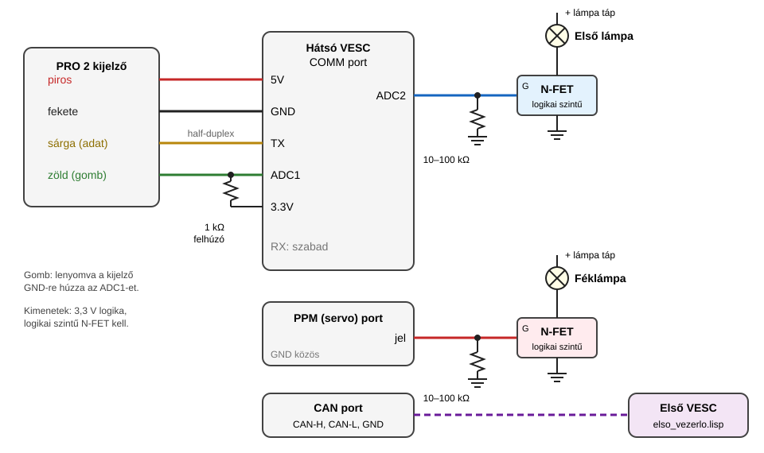

# Vesc-Xiaomi-Display

Xiaomi M365 **PRO 2** kijelző VESC vezérlőhöz (firmware **7.00**), két motorral
(első és hátsó vezérlő CAN-buszon). A kijelző a hátsó vezérlő COMM portjára
csatlakozik. A kijelzőt, a gázt, a féket, a lámpákat és a profilokat egy LispBM
script kezeli.

| Fájl | Hova kerül |
|---|---|
| [`lisp/hatso_vezerlo.lisp`](lisp/hatso_vezerlo.lisp) | hátsó (fő) vezérlő, erre van kötve a kijelző |
| [`lisp/elso_vezerlo.lisp`](lisp/elso_vezerlo.lisp) | első vezérlő (CAN slave) |
| [`docs/referencia-elemzes.md`](docs/referencia-elemzes.md) | a hasonló projektek elemzése, protokoll-leírás |
| [`tests/`](tests/) | szimulátoros tesztek (a script logikája PC-n futtatva) |
| [`tools/lisp_check.py`](tools/lisp_check.py) | statikus ellenőrző a 7.00-s firmware függvénylistája alapján |
| [`tools/balansz_modell.py`](tools/balansz_modell.py) | durva fizikai modell a balansz mód erősítéseinek becsléséhez |

> **Ez a `Balance` ág.** A `main` ághoz képest a **balansz mód** (egykerekes
> indulás, [leírás lent](#balansz-mód-kísérleti)) van benne. **Kísérleti**, valódi
> rolleren még nincs kipróbálva.

> ⚠️ **Saját felelősségre.** Egy hibás beállítás vagy bekötés váratlan gyorsulást
> vagy fékvesztést okozhat. Az első próbákat mindig **felemelt kerékkel** végezd.
> A 2-es profil (korlátlan sebesség) közúton a legtöbb helyen nem használható
> legálisan.

## Funkciók

| | 1-es profil („rendőr mód”) | 2-es profil |
|---|---|---|
| Aktiválás | alapértelmezett | bekapcsoláskor **nyomva tartott gázkar** (2 sípolás) |
| Motorok | csak a hátsó | mindkettő |
| Indulás | **3 km/h-s berúgás** kell | bármikor |
| ECO | 6 km/h, 100 W | 25 km/h, 50% fázisáram ¹ |
| D | 20 km/h, 300 W ¹ | korlátlan sebesség, **60% fázisáram** |
| S | 25 km/h, 500 W | korlátlan |
| Kijelző álló helyzetben | sebesség (0) | **akku %** |

¹ Ezt az értéket nem adtad meg, ezért becsült értéket írtam be. A
`hatso_vezerlo.lisp` elején egy sorban átírható (`p1-drive`, `p2-eco`).

A „korlátlan” 1000 km/h-s és 1 500 000 W-os korlátot jelent. Ilyenkor a VESC
Tool-ban beállított motoráram- és akkuáram-limitek maradnak érvényben.

**Kijelző gomb (a kijelzőben, zöld vezeték → RX):**
- 1x nyomás: első lámpa ki/be (az első vezérlő PPM kimenete + lámpa ikon).
- 2x gyors nyomás: módváltás **D → S → ECO → D**, 1 sípolással.
- Hosszú (1,5 s-nál hosszabb) nyomás: nincs funkciója.

**Féklámpa (PPM kimenet):** folyamatosan világít. Fékezéskor azonnal kialszik,
majd 5 Hz-cel villog, amíg a fékkar be van húzva.

**Kijelzőn:** sebesség (km/h), akku töltöttség, mód (ECO/D/S), hőfok ikon
(vezérlő ≥ 80 °C vagy motor ≥ 100 °C, mindkét vezérlőt figyeli), lámpa ikon és
hibakód.

**Gáz és fék:** a kijelző nyers gáz- és fékértékét a script az **ADC app**
bemenetére küldi (`app-adc-override`). Így a tartomány, a holtjáték, a
gázgörbe, a rámpák és a vezérlési mód a VESC Tool-ban hangolható (App Settings →
ADC), a script módosítása nélkül.

**Biztonság:**
- A profil eldöntéséig (kb. 2 s a kijelző indulása után) nincs motorkimenet.
- A 2-es profilban addig nincs kimenet, amíg el nem engeded a gázt.
- Ha a kijelző elhallgat (kábelhiba), a VESC saját timeout-ja leállítja a motort,
  mert a script csak friss kijelzőkeretre küld gázértéket.
- Ha az első vezérlő 1 másodpercig nem kap üzenetet a hátsótól, letiltja a saját
  motorját.

## Bekötés



**Hátsó vezérlő, COMM port:**

| Kijelző vezeték | VESC láb | Megjegyzés |
|---|---|---|
| piros | 5V | a kijelző tápja |
| fekete | GND | |
| sárga (adat) | **TX** | half-duplex, csak a TX lábat használja |
| zöld (gomb) | **RX** | **470 Ω** felhúzó ellenállás az RX és a **3.3V** közé. A gomb a kijelzőben van, lenyomva a kijelző GND-re húzza ezt a vezetéket. Opcionálisan 1 µF kondenzátor az RX és a GND közé. |

**ADC1:** szabad. Ajánlott egy 10 kΩ-os ellenállással GND-re kötni, hogy
induláskor, a script elindulása előtt az ADC app ne lebegő bemenetet olvasson
(ld. [Safe Start](#hátsó-vezérlő-app-settings)).

**Kimenetek** (3,3 V-os logikai jel, N-csatornás MOSFET-tel):

| Vezérlő, láb | Fogyasztó |
|---|---|
| hátsó, PPM jel (servo) | féklámpa MOSFET gate |
| **első**, PPM jel (servo) | első lámpa MOSFET gate (a hátsó CAN-en kapcsolja) |

**Miért nem az ADC2-n van a lámpa?** A firmware engedi az ADC lábat
kimenetnek állítani (`gpio-configure`), és a script ezt csinálta is. Sok VESC
lapon viszont az ADC bemenetek elé védő- és szűrőkör kerül (soros ellenállás,
osztó vagy lehúzó ellenállás, kondenzátor), hogy 5 V-os gázkart is el lehessen
viselni. Ezen keresztül a láb nem tud elég feszültséget vagy áramot adni egy
MOSFET gate-jének. A PPM láb közvetlenebbül megy a processzorra, a hátsón ez
működik is, ezért a lámpa az első vezérlő ugyanilyen PPM lábára került. Ha
mégis a hátsó ADC2-t szeretnéd: `(def headlight-on-front nil)`, és mérd meg a
lábon a ~3,3 V-ot bekapcsolt lámpánál.

**Miért ilyen kicsi (470 Ω) a felhúzó?** A kijelző a zöld vezetéket
nyugalmi állapotban is terheli. Az eredeti projektek 1 kΩ-ot használnak, és a
„véletlenszerű” gombolvasást 470 Ω-mal szüntették meg. Lenyomáskor 470 Ω-on
~7 mA folyik, ez a 3.3V lábnak nem gond. Az 1 µF-os kondenzátor a
fantomnyomásokat szűri.

Tanácsok a kimenetekhez:
- **Logikai szintű** N-FET kell (pl. AO3400, IRLZ44N, IRLML6344), amelyik 3,3 V
  gate-feszültségnél teljesen kinyit. „Sima” IRFZ44N-nel melegedni fog.
- Tegyél 10–100 kΩ-os **gate–GND lehúzó ellenállást**, hogy a lámpa ne
  villanjon fel, amíg a VESC bootol.
- Ha induktív a terhelés (relé), szabadonfutó diódát is tegyél mellé.
- Ha a lámpa a kijelzővel közös 5 V-ról kap tápot, a feszültségesés elhúzhatja
  a gáz- és fékértéket. Ilyenkor külön tápról járasd a lámpát.

**Első vezérlő:** csak CAN (CAN-H, CAN-L, GND) a hátsóval, és motor/akku.

## VESC Tool beállítások

Mindkét vezérlőn **7.00**-s firmware fusson, eltérő CAN ID-vel, azonos CAN
sebességgel.

### Mindkét vezérlőn (Motor Settings)
1. Motor setup wizard (FOC). A kerékátmérő és a póluspár legyen pontos, mert ebből
   számolódik a sebesség és a km/h-korlát.
2. **General → Battery:** a cellaszám és az akkutípus legyen helyes, mert ebből
   számolja a VESC a töltöttséget (%).
3. **General → Advanced → Additional faults:** az *Overspeed* hiba legyen
   **kikapcsolva**. A módváltás menet közben is lejjebb teheti a sebességkorlátot,
   és bekapcsolt overspeed hibánál a VESC ilyenkor leállna. Kikapcsolt hibánál a
   korlát fölött a motor csak kifut, nem fékez.
4. Motor hőmérséklet-szenzor, ha van.
5. **Berúgás-érzékelés:** a 3 km/h-s berúgást a script a hátsó motor
   sebességéből látja, amikor a motor még nem kap áramot. **Hall-szenzoros**
   motornál ez biztosan működik. Szenzor nélküli módban csak olyan
   vezérlőn, amelyik méri a fázisfeszültséget (phase filter). Ha a `(status)` szerint
   kézzel pörgetett keréknél 0 km/h látszik, használd a Hall-szenzorokat.

### Hátsó vezérlő (App Settings)
1. **General → App to Use:** `ADC`. Az UART appot a script úgyis leállítja.
2. **ADC → General:**
   - Control Type: **`Current No Reverse Brake ADC2`** (az app 1-es csatornája
     a gáz, a 2-es a fék, mindkettőt a script tölti a kijelzőről, nem a lábakról)
   - Use Filter: `True`
   - Safe Start: `Regular` (**fontos**, ld. lent)
   - Multiple VESCs Over CAN: **`True`** (ezzel kapja az első motor a gázt és a féket)
   - Traction Control: `False`
3. **ADC → Mapping:** kalibráld a gázt és a féket a kijelzőn keresztül
   (ld. a következő pontot).
4. Itt hangolható minden más is: Throttle Curve, Ramp Time Pos/Neg, holtjáték
   (Hysteresis).

**Gáz- és fékkalibráció:** az **1-es profilban** álló helyzetben a script a
berúgás miatt visszafogja a gázt, ezért a VESC Tool ott nem látja a teljes
kitérést. A kalibrációhoz kapcsold be a rollert **a gázkart nyomva tartva**
(2-es profil, 2 sípolás), engedd el a gázt, és utána futtasd az ADC Mapping-et.
Felemelt kerékkel csináld!

**Miért kell a Safe Start:** amíg a script el nem indul, az ADC app a fizikai
ADC1 és ADC2 lábat olvassa. Az ADC1 most szabad, és ha lebeg, akármit mutathat.
A Safe Start csak akkor enged kimenetet, ha a gáz előtte egy ideig nulla volt.
Az ADC1 10 kΩ-os GND-re kötése ezt a kockázatot is megszünteti.

**Az App to Use csak `ADC` lehet.** Ha `ADC and UART` (vagy bármelyik UART-os
app) van beállítva, a script UART-indítása a firmware-ben véglegesen
`No App`-ra állítja át, és akkor a gáz egyáltalán nem működik.

### Első vezérlő
- **App to Use:** `No App`. A parancsokat a hátsó ADC app küldi CAN-en.
- **Servo Output:** kikapcsolva, mert a PPM lábat a lámpa kapcsolja.
- A CAN státuszüzenetek maradjanak bekapcsolva (alapértelmezés), mert ebből látja
  a hátsó vezérlő az első hőmérsékletét és azt, hogy jelen van.

## Feltöltés

1. Hátsó vezérlő: VESC Tool → **VESC Dev Tools → Lisp**, nyisd meg vagy másold be a
   `lisp/hatso_vezerlo.lisp` tartalmát, majd **Upload**. A script ezután minden
   bekapcsoláskor magától indul.
2. Első vezérlő: VESC Tool-ban a CAN-eszközök közül válaszd az első vezérlőt
   (a hátsón keresztül, CAN forward), és ugyanígy töltsd fel az
   `lisp/elso_vezerlo.lisp`-t.
3. Ha a hátsó script `front-cmd-sid` / `front-ack-sid` értékét módosítod, az
   elsőben is ugyanazt állítsd be (`cmd-sid` / `ack-sid`).

Ha nincs első vezérlő, a hátsó script elején legyen `(def front-enabled nil)`.

## Hibakeresés

A Lisp konzolban (REPL) a `(status)` parancs kiírja a profilt, az állapotot, a
módot, a sebességet, a nyers és a kalibrált gáz-/fékértéket, a gomb lábának
állapotát (1 = felengedve, 0 = lenyomva), az észlelt lenyomások számát és az
első vezérlő válaszát.

Ha a VESC Tool-ban az App típusát vagy a Servo Output beállítást megváltoztatod,
a firmware újraindítja az appokat, és közben a lámpák és a gomb lábait is
átállítja. A script ezeket fél másodpercen belül visszaállítja.

### A gomb nem működik

1. Csatlakozz a hátsó vezérlőhöz, és nyisd meg a **VESC Dev Tools → Lisp**
   konzolt. Bekapcsoláskor kiírja: `Profil: 1, gomb lab: 1 (1 = felengedve)`.
2. Írd be: `(gomb-teszt)`, és 5 másodpercig nyomogasd a gombot. A script
   0,2 s-onként kiírja a gomb lábának állapotát (`lab = 1`, lenyomva
   `lab = 0  LENYOMVA`), a végén pedig az észlelt lenyomások számát.
3. Minden lenyomásnál és felengedésnél megjelenik egy `gomb le` / `gomb fel`
   sor, utána a művelet: `1x -> lampa BE`, `2x -> mod S`.

| Amit látsz | Ok, teendő |
|---|---|
| mindig `lab = 0` | a zöld vezeték folyamatosan GND-n van, vagy nincs felhúzás: ellenőrizd a 470 Ω-ot és a 3.3V-ot, és hogy tényleg az RX lábon van-e |
| mindig `lab = 1`, nyomásra sem változik | a gomb nem ezt a vezetéket húzza le, vagy a zöld vezeték nem az RX-en van: mérd meg multiméterrel nyomás közben |
| van `gomb le`/`fel`, de nincs művelet | túl hosszú (1,5 s fölötti) a nyomás, vagy 0,4 s-nál lassabb a dupla nyomás |
| `1x -> lampa BE` megjelenik, a kijelzőn a lámpa ikon is, de a lámpa nem ég | fut-e az első vezérlőn az új `elso_vezerlo.lisp`, és bekapcsolt lámpánál ~3,3 V van-e az első vezérlő PPM lábán |
| egyáltalán nincs kiírás, `(status)` sem megy | nem fut a script: töltsd fel újra, és nézd meg a hibaüzenetet |

Ha a konzolon `hiba-control-step` jelenik meg, másold ki és küldd el: a script
hiba esetén is fut tovább, de a hibát jelezni kell.

| Kijelző hibakód | Jelentés |
|---|---|
| 50 | van első vezérlő a CAN-en, de nem válaszol, vagy nem a kért állapotban van (nincs rajta a script?) |
| egyéb | VESC hibakód (`get-fault`), pl. 1 = túlfeszültség, 2 = alacsony feszültség, 3 = DRV, 4 = abs. túláram, 5 = FET túlmelegedés, 6 = motor túlmelegedés |

## Első próba (felemelt kerékkel)

1. Bekapcsolás után 1 sípolás. A kijelzőn az akku % és a D mód látszik, a
   féklámpa világít.
2. Gáz álló helyzetben: a motor **nem** indul (1-es profil). Kézzel pörgesd fel a
   hátsó kereket 3 km/h fölé, ekkor a gáz működik.
3. Fékkar: a féklámpa villog, a motor fékez.
4. Gomb 1x: az első lámpa és a lámpa ikon bekapcsol. Gomb 2x: a mód S lesz,
   1 sípolással.
5. Kikapcsolás, majd bekapcsolás nyomva tartott gázzal: 2 sípolás. Amíg nyomod a
   gázt, semmi nem történik. Elengedés után a gáz álló helyzetből is működik, és
   mindkét motor hajt. Álló helyzetben a kijelző az akku %-ot mutatja.
6. A `(status)` paranccsal ellenőrizd, hogy az első vezérlő válaszol-e
   (`elso-hiba` = nil).

## Balansz mód (kísérleti)

> ⚠️ **Kísérleti funkció, valódi rolleren még nincs kipróbálva.** Egy hibás
> beállítás (rossz tengely vagy előjel, túl nagy erősítés) hátraborulást vagy
> az eleje lecsapódását okozhatja. Csak védőfelszerelésben, üres, sík
> területen próbáld, a lenti lépések sorrendjében.

Egykerekes indulás a hátsó keréken: a roller a hátsó motorral tartja a dőlésszöget,
a gázt és a féket a versenyző helyett adja. Az első motor ilyenkor áll.

**Hogyan működik:** mint egy önegyensúlyozó jármű. Ha az eleje lejjebb kerül a
célszögnél, a hátsó motor gyorsít, és ez visszaemeli. Ha feljebb kerül, a motor
fékez. A sebességet a versenyző a testsúlyával adja: előre dőlve a roller
gyorsít, hátra dőlve lassít. Egy rögzített szöget csak a balanszpontnál lehet
állandó sebességgel tartani, előrébb álló súlyponttal a roller folyamatosan
gyorsul. Ezért van sebességkorlát.

**Bekapcsolás** (minden feltételnek egyszerre kell teljesülnie):
1. **2-es profil** (bekapcsoláskor nyomva tartott gáz).
2. A roller **áll** (1 km/h alatt).
3. Az eleje fel van emelve: a dőlésszög **10° és 35° között** van, oldalra
   legfeljebb 30°-ot dől.
4. **Gáz és fék egyszerre tövig, 1 másodpercig.** Utána 2 sípolás jelzi a
   balansz módot. A célszög a bekapcsolás pillanatában mért szög.
5. **Engedd el a féket**, a gázt tartsd nyomva.

**Kilépés:**
- a **gáz elengedése** (a gázkarnak legalább 70%-on kell maradnia, ez alatt kilép), vagy
- a **fék újbóli behúzása** (a felengedése után), vagy
- ha a féket 2 másodpercen belül nem engeded el.

Kilépéskor 1 sípolás szól, a vezérlés visszakerül a normál módba (a fék azonnal
működik), a gáz pedig **a felengedéséig hatástalan**, hogy ne lőjön ki a
roller. Kilépés után **2 másodpercig** nem lehet újra bekapcsolni.

**Biztonsági kilépések** (mindegyik paraméterezhető):

| Feltétel | Alapérték | Mi történik |
|---|---|---|
| az eleje leért | 4° alatt | kilép |
| túl nagy szög (hátraborulás veszélye) | 50° fölött | kilép |
| oldalra dőlés | 30° fölött | kilép |
| sebességkorlát | 30 km/h fölött | fél másodpercenként sípol, és a célszöget 15°/s-mal legfeljebb 10°-kal (de 8° alá soha) lejjebb viszi, ez lassít. Nem teszi le az elejét, 28 km/h alatt visszaáll az eredeti szög |
| túl gyors | 35 km/h fölött | kilép |
| hátramenet | 3 km/h fölött | kilép |
| nincs kijelzőkeret, VESC hiba, nincs IMU adat | | kilép |

A balansz alatt a dupla gombnyomásos módváltás le van tiltva (az áramkorlátot
nem csökkentheti menet közben), a lámpa kapcsolható. A féklámpa villog, ha a
szabályzó fékez.

### Előfeltétel: IMU a hátsó vezérlőben

A hátsó VESC-nek kell, hogy legyen IMU-ja (gyorsulásmérő + giroszkóp), beépítve
vagy külső modulként. A VESC Tool-ban: **App Settings → IMU**:
- **IMU Type:** a vezérlőn lévő IMU (ha `Off`, a balansz nem indul).
- **AHRS Mode:** `Madgwick Fusion`. A balansz alatt a roller folyamatosan
  gyorsul vagy lassul, ez elhúzhatja a gyorsulásmérőből számolt szöget. Az
  **Accel Confidence Decay** csökkenti ezt a hatást (ugyanúgy, mint a
  balance board-oknál).
- Futtasd a giroszkóp kalibrációt (a roller álljon mozdulatlanul).
- A vezérlő legyen mereven rögzítve, a rezgés zavarja a szögmérést.

### Szögkalibráció

A Lisp konzolban: `(szog)`. Öt másodpercig kiírja a nyers roll/pitch értékeket
és a számolt balansz szöget.
1. Vízszintes rollernél nézd meg, melyik tengely változik, amikor megemeled
   az elejét. Ha a `roll`, állítsd a script elején `(def balance-axis 0)`-ra
   (alapból `1` = pitch).
2. Ha az eleje emelésekor a szög **csökken**, állítsd: `(def balance-invert t)`.
3. Vízszintes rollernél a nyers szög értékét írd be ide:
   `(def balance-level-offset ...)`. Ezután vízszintesen ~0°-ot, felemelt
   elejével pozitív szöget kell mutatnia.

A `(status)` utolsó sora mutatja a balansz állapotát, a szöget, a célszöget, az
áramot és az utolsó kilépés okát.

### Első próbák (ebben a sorrendben)

1. **Irányteszt felemelt hátsó kerékkel.** Állítsd a scriptben
   `(def balance-max-current 5.0)`-ra. Támaszd alá a rollert úgy, hogy a hátsó
   kerék szabadon forogjon, és a váz ~20°-ban álljon. Kapcsold be a balanszot
   (2-es profil, gáz + fék 1 s, utána a fék el). Ha a vázat **lejjebb**
   döntöd, a hátsó keréknek **előre** kell forognia, ha **feljebb**, akkor
   fékeznie vagy hátra forognia. Ha fordítva csinálja, **ne menj tovább**:
   javítsd a `balance-invert` beállítást.
2. **Óvatos próba a földön.** Állítsd vissza az áramkorlátot (40 A), legyen
   veled valaki, és legyen rajtad védőfelszerelés. Az első alkalmakkor csak
   pár méter, kis szöggel. Kilépni a gáz elengedésével tudsz.
3. **Hangolás:**
   - ha az eleje lassan lesüllyed, és a roller nem tudja tartani: `balance-kp`
     növelése (pl. 8 → 10 → 12);
   - ha az eleje fel-le billeg (lengés): `balance-kd` növelése, vagy
     `balance-kp` csökkentése;
   - 15 A/fok fölé ne menj próba nélkül. A modell szerint 20 A/fok körül a
     késleltetés miatt már lengésbe jön (`python3 tools/balansz_modell.py`).

Az alapértékek (Kp 8 A/fok, Kd 1,0 A·s/fok, 40 A, 400 A/s) a modell szerint 0,3
és 1,2 Nm/A közötti motornyomaték-állandónál és 30 ms késleltetésig stabilak.
A valódi rolleren ettől eltérhet.

## Beállítható paraméterek

Mindegyik a `lisp/hatso_vezerlo.lisp` elején van, magyarázattal:

- `p1-eco`, `p1-drive`, `p1-sport`, `p2-eco`, `p2-drive`, `p2-sport`: a módok
  korlátai `(km/h watt fázisáram-szorzó)` formában.
- `boot-mode`: induló mód (1 = D, 2 = ECO, 4 = S).
- `light-default`: az első lámpa induláskor be legyen-e kapcsolva.
- `kick-speed`, `kick-release-speed`: a berúgás sebessége (3 km/h), és hogy ez
  alá lassulva mikor kell újra berúgni (1 km/h).
- `p2-detect-throttle`, `p2-detect-hold`, `p2-detect-window`: a 2-es profil
  aktiválásához szükséges gázmérték, tartási idő és időablak.
- `p2-idle-speed`: e sebesség alatt mutatja a kijelző az akku %-ot a 2-es profilban.
- `button-pin`: a gomb lába (alapból `'pin-rx`). Digitálisan olvassa, lenyomva 0,
  pergésmentesítéssel (lenyomás 3, felengedés 2 minta, 20 ms-onként).
- `double-click-time`, `long-press-time`: a dupla és a hosszú nyomás időzítése.
- `button-log`: a gombesemények kiírása a Lisp konzolra (hibakereséshez).
- `brake-level`, `brake-blink-half`: a féklámpa érzékenysége és villogási
  sebessége.
- `temp-warn-fet`, `temp-warn-motor`: a hőfok ikon határai.
- `front-enabled`, `p1-front-brake`: az első vezérlő használata, és hogy az
  1-es profilban fékezzen-e az első motor (alapból nem, csak a hátsó dolgozik).
- `balance-...`: a balansz mód beállításai (tengely, előjel, vízszint, indítási
  szögtartomány, gáz-/fékküszöbök, PID erősítések, áramkorlátok, biztonsági
  határok, sebességkorlát), mindegyik magyarázattal a script elején.

## Bluetooth (VESC Tool)

A kijelző Bluetooth-a **nem használható** a VESC Tool-hoz:
- A VESC Tool csak a Nordic UART szolgáltatást (NUS) hirdető eszközöket
  listázza (Windows alatt mindet), és azon keresztül a VESC saját csomagjait
  küldi. Ehhez VESC-firmware-es Bluetooth-modul kell: NRF modul vagy VESC Express.
- A kijelző Bluetooth-a a Xiaomi zárt firmware-ét futtatja. Csak
  Xiaomi-formátumú kereteket ad tovább a busz felé, és azokat is átalakítja (az
  app olvasási kérésébe beleteszi a gáz- és fékértéket). A VESC-csomagokat
  nem engedi át. A firmware-t nem lehet úgy lecserélni, hogy a kijelző közben
  működjön.
- Elvben egy saját, PC-n futó „híd” program a VESC-üzeneteket
  Xiaomi-keretekbe csomagolva átjuttathatná. Ez viszont nagyon lassú lenne,
  mert a kijelző a saját ütemében, másodpercenként néhányszor közvetít, és csak
  PC-ről működne, a VESC Tool mobilappal nem. PC-n pedig az USB-kábel egyszerűbb.

**Ajánlott megoldás: VESC Express a CAN-buszon.** A VESC Tool telefonról és
PC-ről is Bluetooth-on kapcsolódik hozzá, és a CAN-en keresztül mindkét
vezérlőt eléri (beállítás, firmware, Lisp, naplózás). A kijelző UART-ját nem
érinti, és a scripteken sem kell változtatni.
- **Kész modul:** hivatalos VESC Express vagy egy vele kompatibilis modul.
- **Házilag:** egy ESP32-S3 fejlesztőpanel és egy 3,3 V-os CAN transceiver
  (pl. SN65HVD230). A [VESC Express](https://github.com/vedderb/vesc_express)
  firmware `S3 N16R8` (ESP32-S3-DevKitC-1 N16R8) és `S3 FH4R2` célhardvere a
  CAN-t a **GPIO16 (TX)** és **GPIO17 (RX)** lábon használja. A firmware az
  ESP32 USB-portján tölthető fel. A tápot a VESC 5V-járól kaphatja. A CAN ID
  legyen egyedi, a CAN sebesség pedig ugyanaz, mint a két vezérlőé.

## Fejlesztés, tesztek

```bash
python3 tools/lisp_check.py lisp/*.lisp
```

```bash
python3 -m unittest discover -s tests -v
```

- `tools/lisp_check.py`: zárójelezés, ismeretlen függvény- és változónevek,
  hibás `conf-set`/`gpio` paraméternevek a 7.00-s firmware forrásából generált
  listához (`tools/fw7_00_symbols.txt`) mérve.
- `tests/`: egy kis LispBM-értelmező szimulált VESC-cel. A valódi Lisp fájlokat
  futtatja, és ellenőrzi a kijelzőprotokollt (CRC, válaszok, visszhang), a
  profilválasztást, a berúgást, a gombot, a féklámpát, a kijelző mezőit és a
  két vezérlő közötti CAN-üzeneteket. Ez nem a valódi LispBM, a hardveres próbát
  nem váltja ki.

A projekt állapota és a döntések: [CLAUDE.md](CLAUDE.md).
