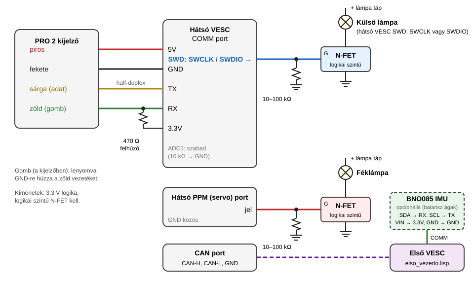

# Vesc-Xiaomi-Display

Xiaomi M365 **PRO 2** kijelző VESC vezérlőhöz (firmware **7.00**), két motorral
(első és hátsó vezérlő CAN-buszon). A kijelző a hátsó vezérlő COMM portjára
csatlakozik. A kijelzőt, a gázt, a féket, a lámpákat és a profilokat egy LispBM
script kezeli.

| Fájl | Hova kerül |
|---|---|
| [`lisp/hatso_vezerlo.lisp`](lisp/hatso_vezerlo.lisp) | hátsó (fő) vezérlő, erre van kötve a kijelző |
| [`lisp/elso_vezerlo.lisp`](lisp/elso_vezerlo.lisp) | első vezérlő (CAN slave), opcionálisan BNO085 IMU |
| [`docs/referencia-elemzes.md`](docs/referencia-elemzes.md) | a hasonló projektek elemzése, protokoll-leírás |
| [`tests/`](tests/) | szimulátoros tesztek (a script logikája PC-n futtatva) |
| [`tools/lisp_check.py`](tools/lisp_check.py) | statikus ellenőrző a 7.00-s firmware függvénylistája alapján |

> ⚠️ **Saját felelősségre.** Egy hibás beállítás vagy bekötés váratlan gyorsulást
> vagy fékvesztést okozhat. Az első próbákat mindig **felemelt kerékkel** végezd.
> A 2-es profil (korlátlan sebesség) közúton a legtöbb helyen nem használható
> legálisan.

## Funkciók

| | 1-es profil („rendőr mód”) | 2-es profil |
|---|---|---|
| Aktiválás | alapértelmezett | bekapcsoláskor **nyomva tartott gázkar** (2 sípolás) |
| Motorok | csak a hátsó | mindkettő |
| Indulás | **3 km/h-s berúgás** kell | bármikor |
| ECO | 6 km/h, 100 W | 25 km/h, 50% fázisáram ¹ |
| D | 20 km/h, 300 W ¹ | korlátlan sebesség, **60% fázisáram** |
| S | 25 km/h, 500 W | korlátlan |
| Kijelző álló helyzetben | sebesség (0) | **akku %** |
| Kipörgésgátló | nincs (csak a hátsó hajt) | **van** (csak az első kereket fogja vissza), induláskor bekapcsolva, 3x gombbal ki/be |

¹ Ezt az értéket nem adtad meg, ezért becsült értéket írtam be. A
`hatso_vezerlo.lisp` elején egy sorban átírható (`p1-drive`, `p2-eco`).

A „korlátlan” 1000 km/h-s és 1 500 000 W-os korlátot jelent. Ilyenkor a VESC
Tool-ban beállított motoráram- és akkuáram-limitek maradnak érvényben.

**Kijelző gomb (a kijelzőben, zöld vezeték → RX):**
- 1x nyomás: lámpa ki/be. Egyszerre kapcsol a kijelző saját lámpája, a lámpa
  ikon és a külső lámpa (a hátsó vezérlő SWD csatlakozójának SWCLK és SWDIO lába).
- 2x gyors nyomás: módváltás **D → S → ECO → D**, 1 sípolással.
- 3x gyors nyomás: **kipörgésgátló** be/ki, 3 sípolással (csak a 2-es
  profilban, az 1-esben nem csinál semmit).
- 4 vagy több nyomás, illetve hosszú (1,5 s-nál hosszabb) nyomás: nincs funkciója.

**Kipörgésgátló (2-es profil):** csak az **első** kereket korlátozza a hátsóhoz
képest. Ha az első kerék `tc-slip` (alapból 2 km/h) fölötti különbséggel
gyorsabban forog, mint a hátsó, az első motor hajtását lineárisan csökkenti, és
`tc-range` (3 km/h) további különbségnél nullára veszi. A **hátsó kerékbe nem
avatkozik bele**. Amikor a csúszás megszűnik, `tc-recover` (0,3 s) alatt áll
vissza a teljes hajtás. Csak a hajtásba szól bele, a fékbe nem. A csökkentés az
első vezérlő áram-szorzóján keresztül hat, így a VESC Tool ADC beállításai
(görbe, rámpa) változatlanul érvényesek.
Induláskor mindig bekapcsolva indul. A hangoláshoz a `(tc-teszt)` konzolparancs
10 s-ig kiírja a két kerék sebességét és a szorzókat.
A ki- és bekapcsolást 3 sípolás jelzi. Ikon alapból nem jelzi (a Bluetooth ikon
nem vezérelhető), ld. [A kipörgésgátló jelzése](#a-kipörgésgátló-jelzése-a-kijelzőn).

**Féklámpa (PPM kimenet):** folyamatosan világít. Fékezéskor azonnal kialszik,
majd 5 Hz-cel villog, amíg a fékkar be van húzva.

**Kijelzőn:** sebesség (km/h), akku töltöttség, mód (ECO/D/S), hőfok ikon
(vezérlő ≥ 80 °C vagy motor ≥ 100 °C, mindkét vezérlőt figyeli), lámpa ikon és
hibakód. A kijelző saját lámpáját a lámpa mező 6-os bitje kapcsolja: a script a
gyári vezérlőhöz hasonlóan 100-at (0x64) küld (`dash-light-value`). A korábbi
1-es érték csak az ikont gyújtotta ki.

**Gáz és fék:** a kijelző nyers gáz- és fékértékét a script az **ADC app**
bemenetére küldi (`app-adc-override`). Így a tartomány, a holtjáték, a
gázgörbe, a rámpák és a vezérlési mód a VESC Tool-ban hangolható (App Settings →
ADC), a script módosítása nélkül.

**Biztonság:**
- A profil eldöntéséig (kb. 2 s a kijelző indulása után) nincs motorkimenet.
- A 2-es profilban addig nincs kimenet, amíg el nem engeded a gázt.
- Ha a kijelző elhallgat (kábelhiba), a VESC saját timeout-ja leállítja a motort,
  mert a script csak friss kijelzőkeretre küld gázértéket.
- Ha az első vezérlő 1 másodpercig nem kap üzenetet a hátsótól, letiltja a saját
  motorját.

## Bekötés



**Hátsó vezérlő, COMM port:**

| Kijelző vezeték | VESC láb | Megjegyzés |
|---|---|---|
| piros | 5V | a kijelző tápja |
| fekete | GND | |
| sárga (adat) | **TX** | half-duplex, csak a TX lábat használja |
| zöld (gomb) | **RX** | **470 Ω** felhúzó ellenállás az RX és a **3.3V** közé. A gomb a kijelzőben van, lenyomva a kijelző GND-re húzza ezt a vezetéket. Opcionálisan 1 µF kondenzátor az RX és a GND közé. |

**ADC1:** szabad. Ajánlott egy 10 kΩ-os ellenállással GND-re kötni, hogy
induláskor, a script elindulása előtt az ADC app ne lebegő bemenetet olvasson
(ld. [Safe Start](#hátsó-vezérlő-app-settings)).

**Kimenetek** (3,3 V-os logikai jel, N-csatornás MOSFET-tel):

| Vezérlő, láb | Fogyasztó |
|---|---|
| hátsó, PPM jel (servo) | féklámpa MOSFET gate |
| hátsó, **SWD csatlakozó SWCLK** (vagy SWDIO) lába | külső (első) lámpa MOSFET gate |

A hátsó SWD csatlakozón általában 3.3V, SWDIO, SWCLK és GND van (néhol NRST
is). A script **mindkét jellábra (SWCLK és SWDIO) kiadja a lámpa jelét**, mert a
feliratok lapról lapra eltérnek: a MOSFET gate-je bármelyikre kerülhet, a source a
GND-re. Az SWCLK a jobb: induláskor a processzor lehúzza, így a lámpa a VESC
bootolása alatt sem villan fel (az SWDIO-t felhúzza). A **3.3V, GND és NRST lábon
nem működik**. Ezek közvetlen processzorlábak, 3,3 V-os jellel. Az SWD programozó
a script indulása után újraindításig nem működik, a VESC Tool USB-n igen.

**Ha a MOSFET 3,3 V-tal nem nyit ki** (nem logikai szintű, pl. IRF520/IRF540-es
modul, IRFZ44N): `(def headlight-mode 'pin-mode-od)`, és egy **1 kΩ-os
ellenállás az SWCLK és az 5V közé**. Ekkor a láb nyitott drainként működik, a gate
bekapcsolt lámpánál 5 V-ot kap (az SWD lábak 5 V-tűrők). Hátránya, hogy
bootoláskor, a script indulásáig a lámpa világít. Jobb megoldás egy logikai szintű
MOSFET (ld. lent).

**Miért nem az ADC2-n vagy az első vezérlő PPM lábán van a lámpa?** Az ADC
bemenetek elé sok lapon védő- és szűrőkör kerül (soros ellenállás, osztó,
kondenzátor), ezen keresztül a láb nem tud MOSFET gate-et kapcsolni. Az első
vezérlő PPM lábán a lámpa nem működött (valószínűleg a láb vagy a nyák sérült).
Ha mégis ott szeretnéd: `(def headlight-on-front t)` a hátsó scriptben, ekkor a
hátsó CAN-en kéri, az első a PPM lábán kapcsolja.

**Miért ilyen kicsi (470 Ω) a felhúzó?** A kijelző a zöld vezetéket
nyugalmi állapotban is terheli. Az eredeti projektek 1 kΩ-ot használnak, és a
„véletlenszerű” gombolvasást 470 Ω-mal szüntették meg. Lenyomáskor 470 Ω-on
~7 mA folyik, ez a 3.3V lábnak nem gond. Az 1 µF-os kondenzátor a
fantomnyomásokat szűri.

Tanácsok a kimenetekhez:
- **Logikai szintű** N-FET kell (pl. AO3400, IRLZ44N, IRLML6344), amelyik 3,3 V
  gate-feszültségnél teljesen kinyit. „Sima” IRFZ44N-nel melegedni fog.
- Tegyél 10–100 kΩ-os **gate–GND lehúzó ellenállást**, hogy a lámpa ne
  villanjon fel, amíg a VESC bootol.
- Ha induktív a terhelés (relé), szabadonfutó diódát is tegyél mellé.
- Ha a lámpa a kijelzővel közös 5 V-ról kap tápot, a feszültségesés elhúzhatja
  a gáz- és fékértéket. Ilyenkor külön tápról járasd a lámpát.

**Első vezérlő:** CAN (CAN-H, CAN-L, GND) a hátsóval, motor/akku, és
opcionálisan a COMM portján egy BNO085 IMU (ld. [Külső IMU](#külső-imu-bno085)).

## VESC Tool beállítások

Mindkét vezérlőn **7.00**-s firmware fusson, eltérő CAN ID-vel, azonos CAN
sebességgel.

### Mindkét vezérlőn (Motor Settings)
1. Motor setup wizard (FOC). A kerékátmérő és a póluspár legyen pontos, mert ebből
   számolódik a sebesség és a km/h-korlát.
2. **General → Battery:** a cellaszám és az akkutípus legyen helyes, mert ebből
   számolja a VESC a töltöttséget (%).
3. **General → Advanced → Additional faults:** az *Overspeed* hiba legyen
   **kikapcsolva**. A módváltás menet közben is lejjebb teheti a sebességkorlátot,
   és bekapcsolt overspeed hibánál a VESC ilyenkor leállna. Kikapcsolt hibánál a
   korlát fölött a motor csak kifut, nem fékez.
4. Motor hőmérséklet-szenzor, ha van.
5. **Berúgás-érzékelés:** a 3 km/h-s berúgást a script a hátsó motor
   sebességéből látja, amikor a motor még nem kap áramot. **Hall-szenzoros**
   motornál ez biztosan működik. Szenzor nélküli módban csak olyan
   vezérlőn, amelyik méri a fázisfeszültséget (phase filter). Ha a `(status)` szerint
   kézzel pörgetett keréknél 0 km/h látszik, használd a Hall-szenzorokat.

### Hátsó vezérlő (App Settings)
1. **General → App to Use:** `ADC`. Az UART appot a script úgyis leállítja.
2. **ADC → General:**
   - Control Type: **`Current No Reverse Brake ADC2`** (az app 1-es csatornája
     a gáz, a 2-es a fék, mindkettőt a script tölti a kijelzőről, nem a lábakról)
   - Use Filter: `True`
   - Safe Start: `Regular` (**fontos**, ld. lent)
   - Multiple VESCs Over CAN: **`True`** (ezzel kapja az első motor a gázt és a féket)
   - Traction Control: **`False`**. A kipörgésgátlót a script végzi. A kiadott
     7.00-s firmware (2026-05-15) ezt a beállítást a Lisp felől nem engedi
     kikapcsolni, ezért **itt kapcsold ki**. Az újabb 7.00-s buildeken a script
     induláskor magától kikapcsolja (csak a RAM-ban).
3. **ADC → Mapping:** kalibráld a gázt és a féket a kijelzőn keresztül
   (ld. a következő pontot).
4. Itt hangolható minden más is: Throttle Curve, Ramp Time Pos/Neg, holtjáték
   (Hysteresis).

**Gáz- és fékkalibráció:** az **1-es profilban** álló helyzetben a script a
berúgás miatt visszafogja a gázt, ezért a VESC Tool ott nem látja a teljes
kitérést. A kalibrációhoz kapcsold be a rollert **a gázkart nyomva tartva**
(2-es profil, 2 sípolás), engedd el a gázt, és utána futtasd az ADC Mapping-et.
Felemelt kerékkel csináld!

**Miért kell a Safe Start:** amíg a script el nem indul, az ADC app a fizikai
ADC1 és ADC2 lábat olvassa. Az ADC1 most szabad, és ha lebeg, akármit mutathat.
A Safe Start csak akkor enged kimenetet, ha a gáz előtte egy ideig nulla volt.
Az ADC1 10 kΩ-os GND-re kötése ezt a kockázatot is megszünteti.

**Az App to Use csak `ADC` lehet.** Ha `ADC and UART` (vagy bármelyik UART-os
app) van beállítva, a script UART-indítása a firmware-ben véglegesen
`No App`-ra állítja át, és akkor a gáz egyáltalán nem működik.

### Első vezérlő
- **App to Use:** `No App`. A parancsokat a hátsó ADC app küldi CAN-en.
- **Servo Output:** kikapcsolva (ha a lámpát az első PPM lábára teszed, kötelező).
- A CAN státuszüzenetek maradjanak bekapcsolva (alapértelmezés), mert ebből látja
  a hátsó vezérlő az első hőmérsékletét és azt, hogy jelen van.
- A kerékátmérő és a póluspár itt is pontos legyen: a kipörgésgátló az első
  vezérlő saját sebességét hasonlítja a hátsóéhoz.
- A kipörgésgátló az első vezérlő áram-szorzóját állítja (a CAN parancsban).

## Feltöltés

1. Hátsó vezérlő: VESC Tool → **VESC Dev Tools → Lisp**, nyisd meg vagy másold be a
   `lisp/hatso_vezerlo.lisp` tartalmát, majd **Upload**. A script ezután minden
   bekapcsoláskor magától indul.
2. Első vezérlő: VESC Tool-ban a CAN-eszközök közül válaszd az első vezérlőt
   (a hátsón keresztül, CAN forward), és ugyanígy töltsd fel az
   `lisp/elso_vezerlo.lisp`-t.
3. Ha a hátsó script `front-cmd-sid` / `front-ack-sid` értékét módosítod, az
   elsőben is ugyanazt állítsd be (`cmd-sid` / `ack-sid`).
4. **A két scriptet mindig együtt frissítsd.** Az új hátsó script az első
   script 2-es verzióját várja. Régebbi első scriptnél a kijelző **60**-as hibát
   mutat, és a lámpa és a kipörgésgátló nem működik.

Ha nincs első vezérlő, a hátsó script elején legyen `(def front-enabled nil)`.

**Ha a feltöltés hibával áll meg** (a konzolon `Error: read_error` vagy
`eval_error`, alatta `Line:` / `Column:`), a script egyáltalán nem fut: küldd el a
képet a sor- és oszlopszámmal. (Példa: a 7.00-s firmware olvasója legfeljebb 256
karakteres szöveget enged egy idézőjelpár között, a hosszabbnál `read_error`.)

**`Attempted to write to const heap at ..., but it is already occupied`**, utána
`read_error`, `Current: ~CHANNEL~`: a VESC a scriptet egy flash-képből indítja
(`image-save`), és a kép írási mutatója elavult. **Töltsd fel újra a scriptet
arra a vezérlőre** (Upload): a feltöltés törli és újraépíti a képet. Az okát a
script már kerüli (a futás közben betöltött könyvtári makrókat, pl. `looprange`,
még a kép mentése előtt betölti). Előfordulhat még, ha a konzolba elgépelt,
ismeretlen nevet írsz, és utána rögtön kikapcsolod a VESC-et: ilyenkor is a
feltöltés a megoldás.

## Hibakeresés

A Lisp konzolban (REPL) a `(status)` parancs kiírja a profilt, az állapotot, a
módot, a sebességet, a nyers és a kalibrált gáz-/fékértéket, a gomb lábának
állapotát (1 = felengedve, 0 = lenyomva), az észlelt lenyomások számát és az
első vezérlő válaszát.

Ha a VESC Tool-ban az App típusát vagy a Servo Output beállítást megváltoztatod,
a firmware újraindítja az appokat, és közben a lámpák és a gomb lábait is
átállítja. A script ezeket fél másodpercen belül visszaállítja.

### A gomb nem működik

1. Csatlakozz a hátsó vezérlőhöz, és nyisd meg a **VESC Dev Tools → Lisp**
   konzolt. Bekapcsoláskor kiírja: `Profil: 1, gomb lab: 1 (1 = felengedve)`.
2. Írd be: `(gomb-teszt)`, és 5 másodpercig nyomogasd a gombot. A script
   0,2 s-onként kiírja a gomb lábának állapotát (`lab = 1`, lenyomva
   `lab = 0  LENYOMVA`), a végén pedig az észlelt lenyomások számát.
3. Minden lenyomásnál és felengedésnél megjelenik egy `gomb le` / `gomb fel`
   sor, utána a művelet: `1x -> lampa BE`, `2x -> mod S`.

| Amit látsz | Ok, teendő |
|---|---|
| mindig `lab = 0` | a zöld vezeték folyamatosan GND-n van, vagy nincs felhúzás: ellenőrizd a 470 Ω-ot és a 3.3V-ot, és hogy tényleg az RX lábon van-e |
| mindig `lab = 1`, nyomásra sem változik | a gomb nem ezt a vezetéket húzza le, vagy a zöld vezeték nem az RX-en van: mérd meg multiméterrel nyomás közben |
| van `gomb le`/`fel`, de nincs művelet | túl hosszú (1,5 s fölötti) a nyomás, vagy 0,4 s-nál lassabb a dupla nyomás |
| `1x -> lampa BE` megjelenik, a kijelzőn a lámpa ikon is, de a lámpa nem ég | ld. [A lámpa nem működik](#a-lámpa-nem-működik) |
| egyáltalán nincs kiírás, `(status)` sem megy | nem fut a script: töltsd fel újra, és nézd meg a hibaüzenetet |

Ha a konzolon `hiba-control-step` jelenik meg, másold ki és küldd el: a script
hiba esetén is fut tovább, de a hibát jelezni kell.

### A lámpa nem működik

Két külön lámpa van: a **kijelző saját lámpája** (a kijelző kapcsolja a
hátsótól kapott lámpa mező alapján) és a **külső lámpa** (MOSFET). Az ikon
mindkettőtől függetlenül kigyullad. A külső lámpa alapból a **hátsó vezérlő
SWD csatlakozójának SWCLK lábán** van (`headlight-pin`).

1. **Kijelző lámpája:** a script a gyári vezérlő értékét, 100-at (0x64) küldi
   (`dash-light-value`). Ha nem gyullad ki, futtasd a hátsó vezérlőn az
   `(ikon-teszt)`-et: 3 s-onként más értéket küld a lámpa mezőben, a lépés száma a
   sebesség helyén látszik. A 7. (64) és a 9. (100) lépésnél kellene égnie.
   - Valamelyik lépésnél kigyullad: azt az értéket írd a `dash-light-value` sorba.
   - Egyiknél sem, de az ikon kigyullad: a kijelző kapcsolna, a lámpa nem kap
     elég tápot. A kijelző lámpája a kijelző tápjáról (a piros vezeték, a VESC
     5V-ja) ég: mérd a piros és a fekete vezeték között **bekapcsolt lámpával**,
     legalább 4,5 V kell (a 3.3V-ra kötött kijelző működik, de a lámpája nem).
     Ha leesik, a VESC 5 V-os kimenete gyenge: a kijelzőt külön 5 V-os
     step-downról járasd (közös GND). Ellenőrizd a lámpa csatlakozóját a kijelzőben.
2. **Külső lámpa, hátsó vezérlő konzolja:** `(lampa-teszt)`. Hatszor be- és
   kikapcsolja a lámpát (2 s-onként, minden bekapcsolásnál egy sípolás), kiírja
   mindkét SWD láb visszaolvasott szintjét (`lab`, `masik lab`), a végén pedig egy
   `EREDMENY:` sort. Közben **mérd multiméterrel a MOSFET gate (a vezeték vége) és
   a GND között** a feszültséget:

   | Eredmény és mérés | Ok | Teendő |
   |---|---|---|
   | `rendben kapcsol`, a gate-en BE-nél ~3,3 V, KI-nél 0 V, a lámpa mégsem ég | a jel kijut, a MOSFET nem kapcsol | a MOSFET 3,3 V-tal nem nyit ki (ha 5 V-tal próbáltad ki, az erre nem bizonyíték): logikai szintű MOSFET, vagy `headlight-mode 'pin-mode-od` + 1 kΩ 5V-ra. Közös a GND a lámpa tápjával? |
   | `rendben kapcsol`, de a gate-en nincs feszültség | a vezeték nem az SWCLK/SWDIO lábon van | mérd végig a csatlakozó lábait a GND-hez: a teszt alatt az a kettő vált 0 és 3,3 V között, amelyikre kötni kell |
   | `bekapcsolva sem megy magasra` | valami lehúzza a lábat | húzd le a lámpa vezetékét, és futtasd újra: ha úgy jó, a MOSFET gate zárlatos, vagy túl kicsi ellenállás húzza GND-re |

   **Csere-próba (1 perc, eldönti, hol a hiba):** kösd a lámpa MOSFET-jének
   jelvezetékét ideiglenesen a féklámpáé helyett a hátsó **PPM jel** lábára (ami
   bizonyítottan működik). Ez fékezés nélkül folyamatosan 3,3 V-ot ad. Ha a lámpa
   így ég, a modul, a lámpa és a tápja jó, a hiba az SWD bekötésben van (rossz láb,
   vezeték). Ha így sem ég, a hiba a lámpa ágában van (a modul 3,3 V-tal nem nyit
   ki, a lámpa tápja vagy a GND hiányzik), nem a vezérlőben.

   **Induláskor felvillan, a gombra mégsem kapcsol?** A firmware induláskor az
   SWD lábak kimeneti regiszterét 1-re állítja (`hwconf/board.h`), a lábakat lebegni
   hagyja (nincs le- vagy felhúzó), és az SWCLK-t egy pillanatra ki is hajtja (a
   „HALL2 és SWCLK összekötve = gyári beállítások” ellenőrzés). A korábbi script a
   kimenetre állításkor szintén egy pillanatra magasra vitte a lábat (az új már
   előbb 0-t ír). A villanás azt mutatja, hogy a vezeték, a MOSFET és a lámpa
   kapcsolható, **de azt nem, hogy a MOSFET 3,3 V-tal kinyit**: a lebegő gate a
   lámpa tápjáról 3,3 V fölé is feltöltődhet. Tegyél egy **10 kΩ-os ellenállást a
   gate és a GND közé**, és nézd meg a `(lampa-teszt)`-et. (Az SWCLK-t soha ne
   kösd össze a HALL2-vel: attól a VESC induláskor törli a beállításait.)

3. **Ha a lámpát az első vezérlő PPM lábára kötöd** (`(def headlight-on-front t)`):
   a hátsó `(lampa-teszt)`-je az első vezérlő visszajelzését írja ki (`elso
   vezerlo parancs` = megkapta-e, `lab` = az első lámpa lábának szintje), az
   első vezérlő Lisp konzolján pedig a `(lampa-teszt)` közvetlenül kapcsolja
   a PPM lábat (és kiírja az App to Use beállítást: 0 = No App legyen). Mérés a
   PPM csatlakozó jel és GND lába között, ugyanúgy, mint fent.

| Kijelző hibakód | Jelentés |
|---|---|
| 50 | van első vezérlő a CAN-en, de nem válaszol, vagy nem a kért állapotban van (nincs rajta a script?) |
| 60 | az első vezérlő válaszol, de **régi scripttel**: töltsd fel az új `elso_vezerlo.lisp`-et (enélkül nincs külső lámpa és kipörgésgátló) |
| egyéb | VESC hibakód (`get-fault`), pl. 1 = túlfeszültség, 2 = alacsony feszültség, 3 = DRV, 4 = abs. túláram, 5 = FET túlmelegedés, 6 = motor túlmelegedés |

### A kipörgésgátló jelzése a kijelzőn

A **Bluetooth ikon nem vezérelhető**: a gyári rendszerben a kijelző saját BLE
modulja kapcsolja (telefon csatlakozásakor), és az `(ikon-teszt)` egyik lépése sem
gyújtotta ki (2026-11-25). A lámpa mező bármely bitje a **lámpa ikont** gyújtja ki,
ezért arra sem jó. Alapból tehát nincs ikon (`tc-icon-field -1`), a
kipörgésgátló kapcsolását a 3 sípolás jelzi.

Ha mégis egy ikon jelezze a bekapcsolt kipörgésgátlót (2-es profilban):

1. Hátsó vezérlő Lisp konzol: `(ikon-teszt)`. 14 lépés, 3 s-onként, a lépés
   száma a sebesség helyén látszik, a konzol kiírja, mit küld.
2. Válaszd ki azt a lépést, amelyiknél a kívánt ikon gyullad ki, és a konzol
   sorában lévő `tc-icon-field` és `tc-icon-bit` értéket írd a script elejére. A
   mód mező lépései (11–14) a gyári kiosztás szerint: +8 töltés-animáció, +32
   lakat, +64 mph felirat, +128 hőmérő (a hőmérő a túlmelegedést is jelzi).

## Első próba (felemelt kerékkel)

1. Bekapcsolás után 1 sípolás. A kijelzőn az akku % és a D mód látszik, a
   féklámpa világít.
2. Gáz álló helyzetben: a motor **nem** indul (1-es profil). Kézzel pörgesd fel a
   hátsó kereket 3 km/h fölé, ekkor a gáz működik.
3. Fékkar: a féklámpa villog, a motor fékez.
4. Gomb 1x: a kijelző lámpája, a külső lámpa (hátsó SWD / SWCLK) és a lámpa ikon bekapcsol. Gomb
   2x: a mód S lesz, 1 sípolással. Ha a lámpa nem ég: `(lampa-teszt)` és `(ikon-teszt)`.
5. Kikapcsolás, majd bekapcsolás nyomva tartott gázzal: 2 sípolás. Amíg nyomod a
   gázt, semmi nem történik. Elengedés után a gáz álló helyzetből is működik, és
   mindkét motor hajt. Álló helyzetben a kijelző az akku %-ot mutatja.
6. A `(status)` paranccsal ellenőrizd, hogy az első vezérlő válaszol-e
   (`elso-hiba` = nil, `elso-verzio` = 2).
7. Kipörgésgátló a 2-es profilban, felemelt kerekekkel: adj kevés gázt, és fogd
   meg kézzel a **hátsó** kereket. A `(tc-teszt)` kiírásában az első kerék
   szorzója 1 alá esik, az első motor visszavesz. (Ha az elsőt fogod meg, nem
   történik semmi: a hátsóba a kipörgésgátló nem avatkozik bele.) Gomb 3x: 3
   sípolás, a kipörgésgátló kikapcsol, ugyanettől a próbától már nem vesz vissza.

## Beállítható paraméterek

Mindegyik a `lisp/hatso_vezerlo.lisp` elején van, magyarázattal:

- `p1-eco`, `p1-drive`, `p1-sport`, `p2-eco`, `p2-drive`, `p2-sport`: a módok
  korlátai `(km/h watt fázisáram-szorzó)` formában.
- `boot-mode`: induló mód (1 = D, 2 = ECO, 4 = S).
- `light-default`: az első lámpa induláskor be legyen-e kapcsolva.
- `headlight-on-front`, `headlight-pin`, `headlight-pin2`: a külső lámpa a hátsó
  vezérlő `headlight-pin` (alapból `'pin-swclk`) és `headlight-pin2` (alapból
  `'pin-swdio`, `nil` = nincs) lábán, az SWD csatlakozón; vagy `headlight-on-front
  t` esetén az első vezérlő PPM lábán (CAN-en kapcsolva).
- `headlight-mode`: `'pin-mode-out` (3,3 V-os kimenet) vagy `'pin-mode-od`
  (nyitott drain, 1 kΩ felhúzóval az 5V-ra: 5 V-os gate-jel).
- `dash-light-value`: a kijelzőnek küldött lámpa érték (100 = a kijelző lámpája
  is ég, 1 = csak az ikon).
- `tc-icon-field`, `tc-icon-bit`: a kipörgésgátló jelzése a kijelzőn (alapból
  -1 = nincs; a Bluetooth ikon nem vezérelhető). Választás: `(ikon-teszt)`.
- `tc-default`, `tc-slip`, `tc-range`, `tc-recover`: a kipörgésgátló induló
  állapota, mennyivel foroghat az első kerék gyorsabban a hátsónál (km/h), az a
  további különbség, amelynél az első hajtása nullára csökken (km/h), és a
  visszaállás ideje (s). Szigorúbbhoz kisebb `tc-slip` és `tc-range`, lazábbhoz
  nagyobb. A hátsó kerékbe a kipörgésgátló nem avatkozik bele.
- `kick-speed`, `kick-release-speed`: a berúgás sebessége (3 km/h), és hogy ez
  alá lassulva mikor kell újra berúgni (1 km/h).
- `p2-detect-throttle`, `p2-detect-hold`, `p2-detect-window`: a 2-es profil
  aktiválásához szükséges gázmérték, tartási idő és időablak.
- `p2-idle-speed`: e sebesség alatt mutatja a kijelző az akku %-ot a 2-es profilban.
- `button-pin`: a gomb lába (alapból `'pin-rx`). Digitálisan olvassa, lenyomva 0,
  pergésmentesítéssel (lenyomás 3, felengedés 2 minta, 20 ms-onként).
- `double-click-time`, `long-press-time`: a dupla és a hosszú nyomás időzítése.
- `button-log`: a gombesemények kiírása a Lisp konzolra (hibakereséshez).
- `brake-level`, `brake-blink-half`: a féklámpa érzékenysége és villogási
  sebessége.
- `temp-warn-fet`, `temp-warn-motor`: a hőfok ikon határai.
- `front-enabled`, `p1-front-brake`: az első vezérlő használata, és hogy az
  1-es profilban fékezzen-e az első motor (alapból nem, csak a hátsó dolgozik).
- `beep-spacing`: a sípolások közötti legkisebb szünet, hogy a 2-3 sípolás
  külön hallatsszon.

## Külső IMU (BNO085)

A BNO085 nincs benne a VESC Tool IMU listájában (a firmware nem ismeri), ezért
a script olvassa. A `main` ágon nincs szükség IMU-ra; a **Balance** és az
**Advanced-Balance** ág használja. A meghajtó az első vezérlő scriptjében van
(`elso_vezerlo.lisp`, `bno-enabled`), mert a hátsó COMM portot a kijelző és a
gomb foglalja. A 7.00-s firmware-ben a Lisp csak a COMM portot tudja UART-ként
használni. I2C-t több lábon is tud, de a második (BLE / „permanent UART”) port
lábain nem.

Bekötés az **első vezérlő COMM portjára** (a kétportos lapokon ez a **COM1**:
ugyanaz a port, amelyiken a hátsón a kijelző van; a COM2 a BLE / permanent UART):

| BNO085 | Első vezérlő COMM | Megjegyzés |
|---|---|---|
| VIN | 3.3V | (5V csak akkor, ha a panelen van feszültségszabályzó) |
| GND | GND | |
| SDA | RX | I2C mód (PS0 = PS1 = 0, a legtöbb panelen ez az alap) |
| SCL | TX | |

A címet (0x4A vagy 0x4B) a script megkeresi. Ha nem találja, a következő
próbánál felcseréli az SDA-t és az SCL-t, így a fordítva bekötött vezetékkel is
működik. Az I2C sebesség 100 kHz (`bno-i2c-rate`), ez hosszabb vezetékkel és
gyenge felhúzóval is biztos. UART-RVC módban (`(def bno-mode 'rvc)`, PS0 = 1)
elég a BNO085 SDA/TX lábát az RX-re kötni.

Az I2C indítása a COMM port UART appját leállítja; az első vezérlőn amúgy is
`No App` legyen. A `bno-enabled` csak a Balance és az Advanced-Balance ág első
scriptjében `t`: a BNO085-höz azok közül töltsd fel **mindkét** scriptet.

**Ellenőrzés** az első vezérlő Lisp konzolján: `(bno)`.

| Kiírás | Jelentés, teendő |
|---|---|
| `allapot run`, a `mintak` nő, a szögek változnak a döntéskor | működik |
| `Nem talalhato` (`allapot detect`) | nincs válasz: táp (3.3V), GND, SDA/SCL az RX/TX lábon, a panel I2C módban van-e (PS0 = PS1 = 0) |
| `Megtalalva, de nem jon adat`, a `ujrainditas` nő | a szenzor válaszol, de a csomagok nem jönnek át: vezetékhossz, felhúzó ellenállások (a panelen általában 4,7–10 kΩ van) |
| `A BNO085 olvasasa ki van kapcsolva` | a `main` ág első scriptje van fent: a balansz ágak scriptjét töltsd fel |

Bekapcsoláskor a konzolon megjelenik: `BNO085 megtalalva, cim 0x4A` (felcserélt
bekötésnél ezt is kiírja).

## Bluetooth (VESC Tool)

A kijelző Bluetooth-a **nem használható** a VESC Tool-hoz:
- A VESC Tool csak a Nordic UART szolgáltatást (NUS) hirdető eszközöket
  listázza (Windows alatt mindet), és azon keresztül a VESC saját csomagjait
  küldi. Ehhez VESC-firmware-es Bluetooth-modul kell: NRF modul vagy VESC Express.
- A kijelző Bluetooth-a a Xiaomi zárt firmware-ét futtatja. Csak
  Xiaomi-formátumú kereteket ad tovább a busz felé, és azokat is átalakítja (az
  app olvasási kérésébe beleteszi a gáz- és fékértéket). A VESC-csomagokat
  nem engedi át. A firmware-t nem lehet úgy lecserélni, hogy a kijelző közben
  működjön.
- Elvben egy saját, PC-n futó „híd” program a VESC-üzeneteket
  Xiaomi-keretekbe csomagolva átjuttathatná. Ez viszont nagyon lassú lenne,
  mert a kijelző a saját ütemében, másodpercenként néhányszor közvetít, és csak
  PC-ről működne, a VESC Tool mobilappal nem. PC-n pedig az USB-kábel egyszerűbb.

**Ajánlott megoldás: VESC Express a CAN-buszon.** A VESC Tool telefonról és
PC-ről is Bluetooth-on kapcsolódik hozzá, és a CAN-en keresztül mindkét
vezérlőt eléri (beállítás, firmware, Lisp, naplózás). A kijelző UART-ját nem
érinti, és a scripteken sem kell változtatni.
- **Kész modul:** hivatalos VESC Express vagy egy vele kompatibilis modul.
- **Házilag:** egy ESP32-S3 fejlesztőpanel és egy 3,3 V-os CAN transceiver
  (pl. SN65HVD230). A [VESC Express](https://github.com/vedderb/vesc_express)
  firmware `S3 N16R8` (ESP32-S3-DevKitC-1 N16R8) és `S3 FH4R2` célhardvere a
  CAN-t a **GPIO16 (TX)** és **GPIO17 (RX)** lábon használja. A firmware az
  ESP32 USB-portján tölthető fel. A tápot a VESC 5V-járól kaphatja. A CAN ID
  legyen egyedi, a CAN sebesség pedig ugyanaz, mint a két vezérlőé.

## Fejlesztés, tesztek

```bash
python3 tools/lisp_check.py lisp/*.lisp
```

```bash
python3 -m unittest discover -s tests -v
```

- `tools/lisp_check.py`: zárójelezés, ismeretlen függvény- és változónevek,
  hibás `conf-set`/`gpio` paraméternevek a **kiadott 7.00-s** firmware
  (Release 7.00, 2026-05-15) forrásából generált listához
  (`tools/fw7_00_symbols.txt`) mérve. Ami a 7.00-s ágra később került (pl.
  `adc-tc`, `adc-v2-start`), azt a scriptek csak a hibatűrő `conf-try` /
  `conf-set-try` függvényen keresztül használhatják: a kiadott firmware-en egy
  ismeretlen paraméter hibát dob, és leállítja a szálat.
- `tests/`: egy kis LispBM-értelmező szimulált VESC-cel. A valódi Lisp fájlokat
  futtatja, és ellenőrzi a kijelzőprotokollt (CRC, válaszok, visszhang), a
  profilválasztást, a berúgást, a gombot, a féklámpát, a kijelző mezőit, a
  két vezérlő közötti CAN-üzeneteket, a kipörgésgátlót és a BNO085 meghajtót
  (szimulált SHTP eszközzel). Ez nem a valódi LispBM, a hardveres próbát
  nem váltja ki.

A projekt állapota és a döntések: [CLAUDE.md](CLAUDE.md).
